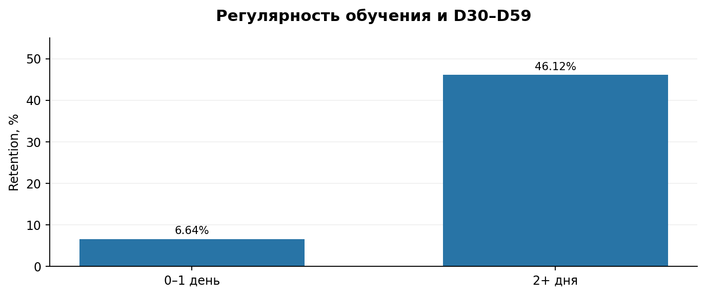
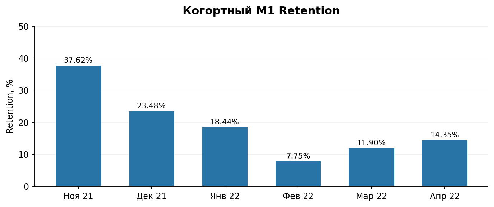
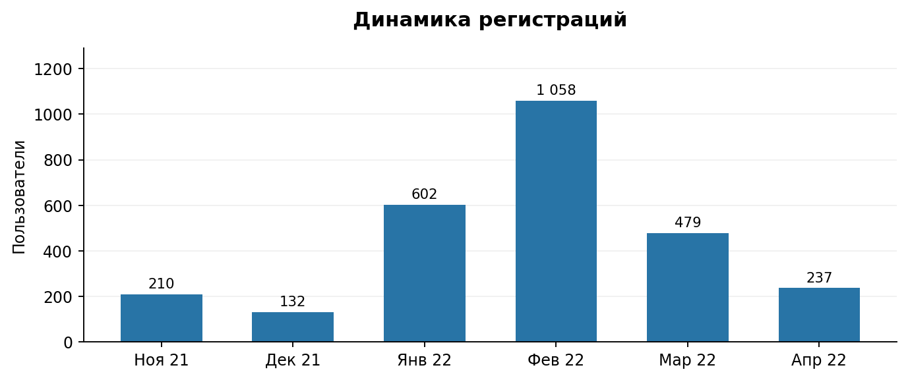
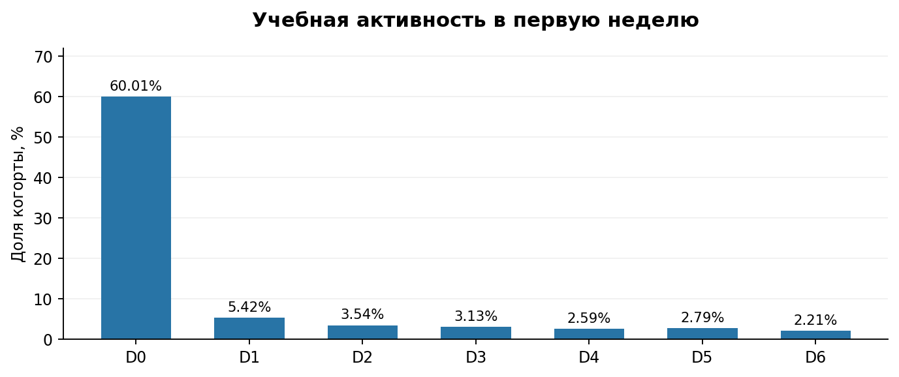
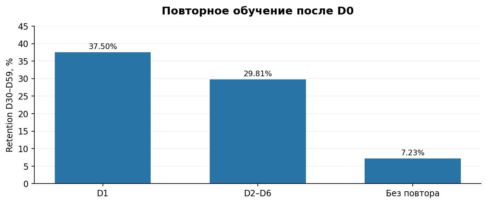

# Анализ Retention платформы IT Resume

## О проекте

**Цель:** исследовать поведение пользователей образовательной платформы IT Resume, выявить факторы, связанные с долгосрочным удержанием, и разработать план повышения Retention.

Проект выполнен на исторических данных за 2021–2022 годы.

**Стек:** PostgreSQL, SQL, DBeaver, продуктовая аналитика, когортный анализ, A/B-тестирование.

## Бизнес-задача

Определить, на каких этапах пользователи прекращают обучение, как ранняя учебная активность связана с долгосрочным удержанием и какие продуктовые изменения целесообразно протестировать.

## Основные результаты

| Метрика | Результат |
|---|---:|
| Пользователей в исследуемой когорте | 2 398 |
| Retention D30–D59 | 10,88% |
| Учебная активность в первые 24 часа (D0) | 60,01% |
| Учебная активность в D1 от всей когорты | 5,42% |
| Повторили обучение в D1 среди активных D0 | 7,23% |
| Не повторили обучение в D1–D6 среди активных D0 | 85,55% |
| Retention D30–D59 при 2+ учебных днях | 46,12%* |
| Retention D30–D59 при 0–1 учебном дне | 6,64%* |

*Показатели удержания по группам ранней активности требуют повторной сверки с исходными SQL-расчётами.*

## Ключевые выводы

1. Основная зона внимания — повторная учебная активность после первого занятия.
2. Пользователи, занимавшиеся в два и более дня первой недели, демонстрируют более высокое долгосрочное удержание.
3. Возвращение к обучению после перерыва также связано с более высоким Retention.
4. На платформе существуют бонусы за активность и недельный марафон, но охват начислениями за марафон невелик.

**Важно:** выявленные связи являются наблюдательными и не доказывают причинного влияния учебной активности на Retention.

## Визуализация результатов

### Регулярность обучения и Retention



Предварительный анализ показывает существенные различия Retention D30–D59 между пользователями с 0–1 и 2+ учебными днями в первую неделю.

Эти различия необходимо подтвердить повторным выполнением SQL-запросов с единым определением Retention.

### Когортный анализ Retention



Когортный анализ показывает снижение M1 Retention с 37,62% в ноябрьской когорте до 7,75% в февральской.

**Примечание:** M1 Retention рассчитывается как наличие активности в следующем календарном месяце после регистрации. Это не то же самое, что Retention D30–D59.

### Динамика регистраций



В феврале 2022 года зарегистрировалось 1 058 пользователей, в марте — 479.

Снижение составило 579 пользователей, или 54,7%.

Сокращение притока новых пользователей необходимо учитывать при интерпретации динамики MAU.

**Примечание:** апрель 2022 года представлен неполным периодом.

### Учебная активность в первую неделю



В первые 24 часа после регистрации учебную активность проявили 60,01% пользователей исследуемой когорты.

В интервале D1 учебная активность наблюдалась у 5,42% всей когорты.

Это указывает на необходимость исследования причин низкой повторной учебной активности.

**Примечание:** D0–D6 — отдельные 24-часовые интервалы от момента регистрации. Один пользователь может учитываться в нескольких интервалах.

### Повторное обучение и долгосрочное удержание



Среди пользователей, начавших обучение в D0, предварительно получены следующие значения Retention D30–D59:

- **37,50%** — повторили обучение в D1;
- **29,81%** — пропустили D1, но занимались в D2–D6;
- **7,23%** — занимались только в D0.

Результаты указывают на связь повторной учебной активности с долгосрочным удержанием.

Эта связь обосновывает проверку продуктовых гипотез через A/B-тестирование, но сама по себе не доказывает причинный эффект.

## Предлагаемые продуктовые решения

1. **Персонализированная рекомендация следующей задачи** — снижение барьера к продолжению обучения.
2. **Напоминания через 24–72 часа** — стимулирование повторной учебной активности.
3. **Короткие задания после перерыва** — упрощение возвращения к обучению.
4. **Персональный семидневный учебный маршрут** — формирование регулярности.
5. **Исследование недельного марафона** — оценка участия, завершения и влияния механики на поведение пользователей.

## Проверка эффективности

Для оценки продуктовых инициатив предлагается рандомизированный A/B-тест с распределением пользователей 50/50.

**Основная метрика:** Retention D30–D59.

**Дополнительные метрики:**
- Доля пользователей с двумя и более учебными днями в первую неделю.
- Доля пользователей, повторивших обучение после D0.
- Количество учебных дней в первую неделю.

Эксперимент должен учитывать необходимый размер выборки и достаточный период наблюдения для измерения Retention D30–D59.

## Ограничения исследования

- Используются исторические данные за 2021–2022 годы, которые не отражают текущие показатели платформы.
- В таблице посещений обнаружены события, не сопоставленные с пользователями.
- Поздние когорты могут иметь неполный период наблюдения.
- Поведенческие связи не позволяют сделать причинно-следственные выводы без эксперимента.
- Некоторые расчёты Retention по группам активности требуют дополнительной сверки.

## Структура проекта

```text
it-resume-retention-analysis/
├── README.md
├── groups.png
├── m1.png
├── registrations.png
├── learning.png
├── return.png
├── sql/
│   ├── 01_data_quality.sql
│   ├── 02_registrations_mau.sql
│   ├── 03_cohort_retention.sql
│   ├── 04_early_learning_activity.sql
│   ├── 05_retention_hypotheses.sql
│   └── 06_rewards_analysis.sql
└── reports/
    └── IT_Resume_Retention_Analytical_Report_with_Charts.docx
```

## Итог

Разработан план повышения удержания пользователей IT Resume с приоритетом на повторную учебную активность в первую неделю после регистрации.

Следующий этап — подтверждение расчётов и проверка предложенных продуктовых решений через A/B-тестирование.
